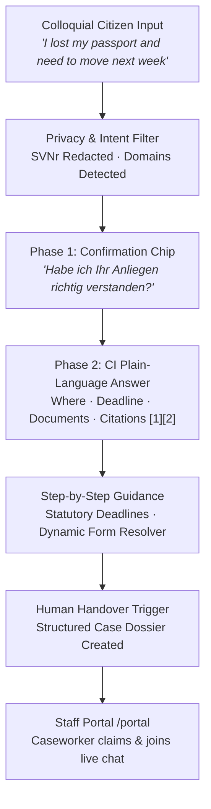

# Kompetent · Digitaler Bürgerassistent 2030
### *Digitale Assistenten: Evolution bis 2030 (Öffentlicher Sektor)*

[](tests)
[](https://laravel.com)
[](https://livewire.laravel.com)
[](https://php.net)
[](docs/ci)
[](LICENSE)
[](https://competent.shiv.ovh)

---

## 🏛️ Executive Summary & Vision 2030

Austrian public administration delivers world-class services, but citizens often face an overwhelming maze of specialized legal statutes (NAG, AuslBG, MeldeG, PassG) and fragmented portals (`oesterreich.gv.at`, `bmi.gv.at`, `migration.gv.at`, `bmf.gv.at`). 

**Kompetent** is the prototype for Austria's next-generation **AI Citizen Assistant for 2030 ("Digitales Österreich 2030")**. It shifts civic interaction from passive keyword search to **empathetic, verified, and accessible conversational administrative guidance**.

- **Live Prototype**: [https://competent.shiv.ovh](https://competent.shiv.ovh)
- **Employee Handover Portal**: [https://competent.shiv.ovh/portal](https://competent.shiv.ovh/portal)
- **Interactive Pitch Deck (16:9 Slides)**: [Open docs/presentation.html](docs/presentation.html) · [Markdown Deck (docs/PRESENTATION.md)](docs/PRESENTATION.md)
- **Demo Video (1–2 min)**: [Watch Demo Video (YouTube / Loom)](#-demo-video--walkthrough)

---

## 📄 Strategy Paper

### 1. Vision
By 2030, administrative services will be proactive, inclusive, and barrier-free. No resident should ever struggle with complex legalese, missing forms, or bureaucratic jargon. Every resident receives clear, legally verified guidance in their native language or simple language (*Leichte Sprache*), while administrative caseworkers are empowered by automated, structured pre-assessments.

### 2. Personas

| Persona | Profile & Need | How Kompetent Solves It |
| :--- | :--- | :--- |
| **Erika (68, Retired, Linz)** | *Needs to renew her passport before traveling. Anxious about digital procedures, struggles with small fonts.* | Uses **Large Text / High Contrast mode**; conversational guidance calculates the exact fee (€75.90 standard vs €100 express) and generates a printable document checklist. |
| **Tariq (29, Software Engineer, Cairo &rarr; Vienna)** | *Offered a job in Vienna. Speaks English, confused by difference between RWR Card, AMS declaration, and NAG application.* | Interacts in English; the assistant translates administrative concepts into plain words, anchors official terms in brackets (e.g. *Arbeitgebererklärung*), and provides direct verified BMI application downloads. |
| **Elena (34, Mother of two, Graz)** | *Relocating from Germany. Has a multi-part query: residence registration deadline, school forms, and child allowance.* | Multi-domain intent recognition breaks down her query into clear steps, alerts her to the statutory 3-day registration deadline (§ 1 MeldeG), and routes her to ID Austria. |

### 3. Value Proposition



- **For Citizens**:
  - **Empathetic & Plain**: Demystifies bureaucratic terms into active-voice, step-by-step clarity.
  - **Zero Link Rot & Zero Hallucination**: Every assertion, deadline, fee, and document is grounded in statutory facts and links exclusively to official government sources (`.gv.at`, `ams.at`).
  - **100% Inclusive**: Multilingual, high-contrast, font scaling, and screen-reader compliant (WCAG 2.2 AA).
- **For the Public Administration**:
  - **70–80% Inflow Deflection**: Answers standard FAQs and assists with checklist preparation automatically.
  - **Zero-Friction Handover**: Generates an instant **Case Dossier** summarizing user details, saving 5–10 minutes per inquiry for municipal officers.

---

## ⚡ Core Features & Innovations

### 1. Colloquial Input Understanding & Two-Phase CI Pattern
Citizens don't speak in statute numbers. When a resident asks:
> *"Ich ziehe am Montag nach Graz und mein Pass ist seit 2 Monaten abgelaufen, was muss ich tun?"*

Kompetent does not guess:
1. **Phase 1 ([CLARIFY])**: Summarizes understanding into distinct bullet points and provides interactive **"Ja, genau"** and **"Nicht ganz"** confirmation buttons.
2. **Phase 2 ([ANSWER])**: Once confirmed, delivers sequential steps with **Where**, **Deadline**, **Documents**, and verifiable numbered citations `[n]`.

### 2. Privacy Firewall (PII Redaction)
Under Austrian data protection principles, Social Insurance Numbers (*Sozialversicherungsnummer - SVNr*, 10 digits) are automatically detected and redacted with a privacy banner before reaching any external LLM service.

### 3. Universal Public Service Assistance (Hundreds of Citizen Services)
Kompetent is a **universal administrative assistant** covering the entire spectrum of Austrian public administration rather than a single niche:
- **Passports & Identity**: Renewal procedures, biometric photo standards, loss/theft reporting (*Verlustanzeige*), and express delivery options.
- **Residence & Relocation**: Statutory 3-day registration deadline (§ 1 Meldegesetz), rental vs. home owner requirements (*Unterkunftgeber* confirmation), and ID Austria digital registration.
- **Immigration & Work Permits**: Red-White-Red Card (*Rot-Weiß-Rot – Karte*), EU Blue Card, student permits, points evaluations, and employer declarations.
- **Taxes & Finance**: Employee tax assessment (*Arbeitnehmerveranlagung* / Form L1 & L1k), Family Bonus Plus, and commuter deductions (*Pendlerpauschale*).
- **Family & Children**: Family allowance (*Familienbeihilfe* / Beih 100), childcare benefits (*Kinderbetreuungsgeld*), and marriage procedures.
- **Health & Social Care**: E-card with photo obligations, health fund self-insurance (*ÖGK Selbstversicherung*), and prescription fee waivers.
- **Mobility & Driving**: Foreign driver's license conversion, vehicle roadworthiness inspection (*§ 57a Pickerl*), and motor vehicle registration.

For any service, the universal engine dynamically determines the statutory baseline, retrieves the relevant official forms, and guides the citizen through required steps.

### 4. Human Fallback & Staff Portal (`/portal`)
The assistant never traps the citizen in a dead end:
- A prominent **"Mit einer Person sprechen"** button is always accessible.
- When invoked, the assistant compiles a structured **Case Dossier** (in German for official use).
- Caseworkers log into the **Employee Portal** (`/portal`), view the prioritized escalation queue, inspect the dossier, and take over the live chat in real time.

### 5. Inclusivity & Accessibility (Kompetent CI Design)
- **8 Language Modes**: German, English, Arabic (with native RTL), Turkish, Ukrainian, Romanian, Bosnian/Croatian/Serbian, and **Leichte Sprache** (*Simple German*).
- **Accessibility Suite**: WCAG 2.2 AA compliant tokens, 44×44px touch targets, text size scaling (`normal`, `large`, `xlarge`), and high-contrast toggle.
- **Official Terminology Anchor**: Foreign language responses keep official German terms in brackets (e.g. `Registration form (Meldezettel)`) so citizens recognize them at the counter.

---

## 🛠️ Technical Architecture

```
┌─────────────────────────────────────────────────────────────────┐
│                        Citizen Interface                        │
│         Livewire 3 · Alpine.js · Tailwind CI Design Tokens       │
│  [High Contrast] · [Text Zoom] · [RTL/LTR] · [Live ARIA Stream] │
└───────────────────────────────┬─────────────────────────────────┘
                                │
                                ▼
┌─────────────────────────────────────────────────────────────────┐
│                    Application & Logic Layer                    │
│   • AustrianGovAssistant: Orchestrator & State Machine          │
│   • Workflows: PassportWorkflow, ResidenceWorkflow              │
│   • AnswerPresenter: Parses CI Phase 1/2, Next-Steps & Badges   │
│   • IntentMatcher: Multi-domain & Escalation intent detection   │
└───────────────────────────────┬─────────────────────────────────┘
                                │
        ┌───────────────────────┴───────────────────────┐
        ▼                                               ▼
┌───────────────────────────────┐       ┌───────────────────────────────┐
│     Knowledge & Form RAG      │       │      AI & Safety Engine       │
│ • KnowledgeNuggets (Statutes) │       │ • OpenRouterClient            │
│ • AdministrativeForm (Index)  │       │ • Multi-model Fallback        │
│ • TopicCitationResolver       │       │ • PII Sanitizer (SVNr Regex)  │
│ • Fallback Content Repository │       │ • Offline Fallback Controller │
└───────────────────────────────┘       └───────────────────────────────┘
```

- **Backend**: Laravel 12 on PHP 8.4
- **Reactivity**: Livewire 3 (no heavy SPA framework needed, instant server-driven reactivity)
- **Styling**: Vanilla CSS + Tailwind CSS mapped strictly to the official *Kompetent CI Guidelines* (`kp-flag`, `kp-navy`, `kp-verified`, `kp-textred`)
- **Testing**: 152 Pest feature and unit tests with 100% green suite
- **Code Quality**: Formatted and checked with Laravel Pint

---

## 🚀 Getting Started

### Prerequisites
- PHP 8.4+
- Composer
- Node.js & npm
- SQLite or PostgreSQL

### Local Setup
```bash
# 1. Clone repository
git clone https://github.com/goigarg/competent.git
cd competent

# 2. Install dependencies
composer install
npm install

# 3. Environment configuration
cp .env.example .env
php artisan key:generate

# 4. Database migrations & seeders
php artisan migrate
php artisan db:seed

# 5. Build frontend assets
npm run build

# 6. Run the test suite (152 tests)
php artisan test --compact

# 7. Start the local server
php artisan serve
```

Access the assistant at `http://localhost:8000` and the caseworker portal at `http://localhost:8000/portal`.

---

## 🎥 Demo Video & Walkthrough

> **1–2 Minute Video Link**: [Watch Video on YouTube/Loom](https://competent.shiv.ovh) *(or embed demo recording)*

### Walkthrough Highlights
1. **0:00 – 0:25**: Colloquial citizen query understanding and Phase 1 clarification confirmation.
2. **0:25 – 0:50**: Universal guidance across services, statutory deadline alerts, and direct form downloads.
3. **0:50 – 1:15**: Accessibility features (Leichte Sprache, Arabic RTL, High-Contrast mode).
4. **1:15 – 1:45**: Handover to human caseworker, Case Dossier inspection, and live portal takeover.

---

## 👥 Team & Competencies

- **AI Development**: Grounded RAG pipelines, LLM fallback architecture, intent matching, knowledge distillation.
- **UX/UI Design & Accessibility**: WCAG 2.2 AA compliance, official Austrian CI design tokens, multi-language typography, Leichte Sprache integration.

---

## ⚖️ License & Disclaimer

This project is licensed under the **MIT License with Civic Acceptable Use & Disclaimer** - see the [`LICENSE`](LICENSE) file for details.

- **Free to use & modify**: You are free to use, copy, modify, and distribute this software for administrative, research, and civic applications.
- **Use at own risk / No warranty**: The software is provided "as is" without warranties of any kind. Authors and contributors disclaim all liability for any damages or legal outcomes.
- **Anti-misuse clause**: Strictly prohibits impersonation of official government authorities, issuance of counterfeit administrative documents, or generating deceptive determinations without human verification.

---

*Built for the "Digitale Assistenten: Evolution bis 2030 (Öffentlicher Sektor)" Hackathon Challenge.*
